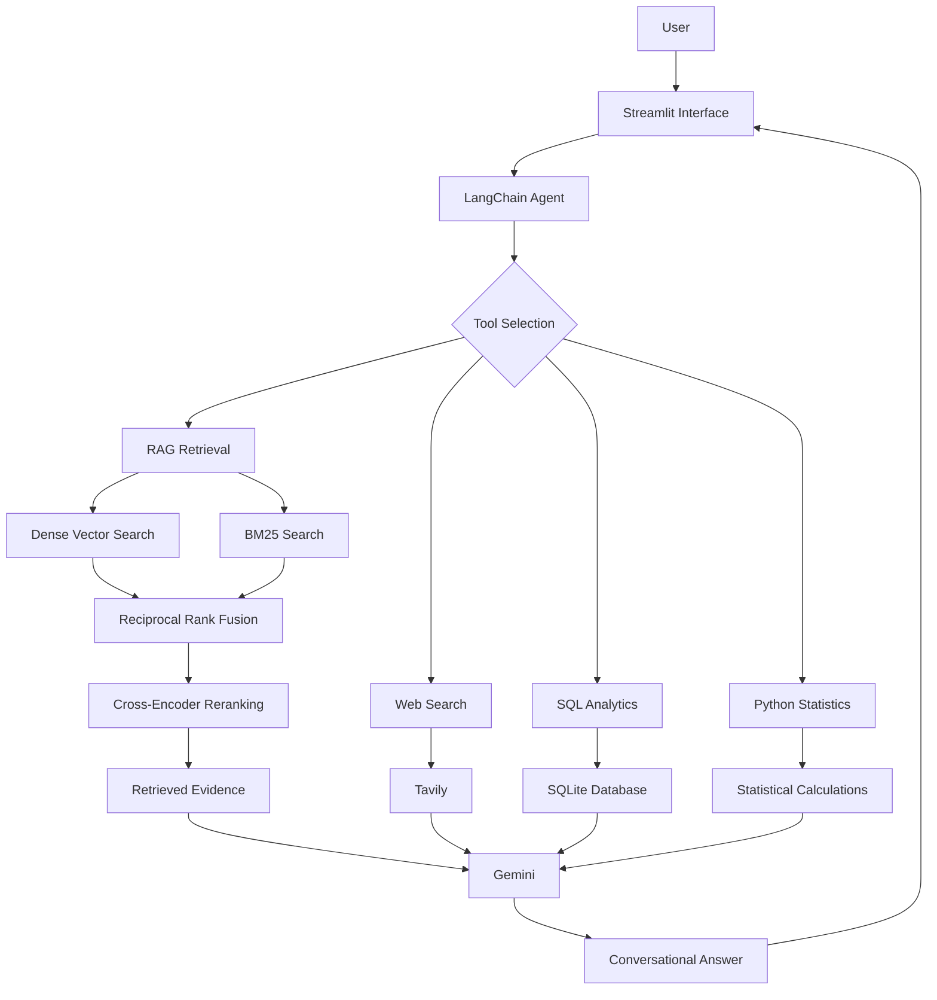

# Enterprise Knowledge & Workflow Intelligence Platform

An agentic Retrieval-Augmented Generation (RAG) platform that combines enterprise documentation retrieval, web research, SQL analytics, and Python-based statistical calculations through an intelligent tool-calling agent.

The platform uses publicly available Microsoft Learn documentation as its knowledge base and a synthetic sales dataset for structured data analysis.

## Overview

Enterprise information is often distributed across technical documentation, structured databases, and external sources. This project brings these information sources together through a unified conversational interface.

Users can ask questions about Azure services, research current information, analyze sales records, and perform numerical calculations without manually selecting the underlying tools.

## Key Features

- **Agentic Tool Selection:** LangChain agent powered by Gemini that selects appropriate tools based on user queries.
- **Retrieval-Augmented Generation:** Answers questions using an indexed Microsoft Learn documentation corpus.
- **Hybrid Retrieval:** Combines dense vector search and BM25 keyword retrieval using Reciprocal Rank Fusion (RRF).
- **Cross-Encoder Reranking:** Reorders retrieved candidates based on query-document relevance.
- **Web Research:** Uses Tavily for external information retrieval.
- **SQL Analytics:** Executes read-only SQL queries against a SQLite sales database.
- **Python Statistics:** Supports numerical calculations and statistical analysis.
- **Evidence-Grounded Answers:** Generates answers using retrieved evidence and source references.
- **Evaluation Framework:** Benchmarks retrieval quality, answer quality, citation support, and agent tool selection.
- **Interactive Interface:** Streamlit-based conversational application.

## System Architecture



## Technology Stack

| Component | Technology |
|---|---|
| Programming language | Python |
| LLM | Google Gemini |
| Agent framework | LangChain / LangGraph |
| Embeddings | Sentence Transformers |
| Embedding model | all-MiniLM-L6-v2 |
| Vector database | ChromaDB |
| Keyword retrieval | BM25 |
| Reranking | Cross-Encoder |
| Web search | Tavily |
| Structured analytics | SQLite, Pandas |
| Frontend | Streamlit |
| Evaluation | Custom Python evaluation framework |

## Knowledge Base and Ingestion

The knowledge base consists of 500 publicly available Microsoft Learn documents distributed across four categories:

- Azure Storage
- Azure Compute
- Azure Database
- Azure Security

The ingestion pipeline performs:

1. Incremental crawling of configured Microsoft Learn sources.
2. URL-scope validation and duplicate detection.
3. Content extraction and metadata collection.
4. Document persistence in JSONL format.
5. Text chunking and metadata preservation.
6. Embedding generation and indexing in ChromaDB.

**Corpus statistics**

| Metric | Value |
|---|---:|
| Unique documents | 500 |
| Categories | 4 |
| Chunks | Approximately 9,500 |
| Embedding dimensions | 384 |
| Chunk size | Approximately 1,000 characters |
| Chunk overlap | 150 characters |

## Retrieval Pipeline

Three retrieval strategies have been implemented and benchmarked.

1. **Dense Retrieval:** Semantic similarity search using ChromaDB.
2. **Hybrid Retrieval:** Combines dense retrieval and BM25 using Reciprocal Rank Fusion.
3. **Hybrid Retrieval + Reranking:** Applies a cross-encoder to rerank retrieved candidates.

### Retrieval Benchmark Results

| Metric | Dense | Hybrid | Hybrid + Reranker |
|---|---:|---:|---:|
| Recall@5 | 77.50% | 72.50% | 70.83% |
| MRR | 0.7675 | 0.6850 | 0.8100 |
| Mean latency | 24.94 ms | 53.28 ms | 259.05 ms |
| P95 latency | 34.43 ms | 63.79 ms | 351.03 ms |

Dense retrieval currently provides the best Recall@5 and latency, while reranking provides the highest MRR. Dense retrieval is therefore the default strategy.

These results are specific to the current retrieval benchmark and configuration.

## Agentic Workflow

The LangChain agent has four tools:

| Tool | Purpose |
|---|---|
| `retrieve_documents` | Retrieves relevant evidence from the local Azure knowledge base |
| `web_search_tool` | Retrieves external information using Tavily |
| `query_sales_database` | Performs read-only SQL analytics |
| `calculate_statistics` | Performs numerical and statistical calculations |

The agent uses query intent to select the relevant tools and can combine multiple tools when a question requires information from different sources.

## Evaluation Framework

The project includes dedicated benchmarks for retrieval, answer quality, and tool selection.

### Answer Quality Evaluation

A 100-question benchmark covers four Azure documentation categories and five question types:

- Factual
- Conceptual
- Procedural
- Comparison
- Multi-document

The evaluation framework measures source recall, evidence support, answer coverage, supported answer rate, citation support, latency, relevance, and faithfulness.

### V1 vs V2 Results

| Metric | V1 | V2 |
|---|---:|---:|
| Source Recall@5 | 83.33% | 83.33% |
| Evidence Support Rate | 83.71% | 85.00% |
| Answer Coverage Rate | 74.63% | 78.29% |
| Supported Answer Rate | 72.38% | 76.21% |
| Citation Support Rate | 92.75% | 95.67% |
| Average Latency | 9.05 s | 9.80 s |
| Relevance (LLM judge) | 4.98/5 | 4.97/5 |
| Faithfulness (LLM judge) | 4.98/5 | 4.99/5 |

V2 introduced improvements to answer-generation instructions, with measurable gains in answer coverage, evidence support, and citation support.

The relevance and faithfulness scores are LLM-judge assessments and should not be interpreted as independently verified ground truth.

### Agent Tool-Selection Evaluation

A separate benchmark contains 100 manually labeled queries.

| Metric | Result |
|---|---:|
| Benchmark queries | 100 |
| Exact tool-set agreement | 100% |
| Tool-selection precision | 100% |
| Tool-selection recall | 100% |
| Tool-selection F1 | 100% |

These measurements evaluate agreement with the benchmark's expected tool selections, not the correctness of the generated answers.

## Project Structure

```text
EnterpriseAIPlatform/
│
├── app.py
├── requirements.txt
├── README.md
├── .gitignore
│
├── data/
│   └── analytics/
│       └── sales.csv
│
├── src/
│   ├── agent/
│   │   └── agent.py
│   │
│   ├── generation/
│   │   └── answer_generator.py
│   │
│   ├── ingestion/
│   │   ├── loader.py
│   │   ├── sources.py
│   │   ├── chunker.py
│   │   ├── pipeline.py
│   │   └── validate_corpus.py
│   │
│   ├── retrieval/
│   │   ├── search.py
│   │   ├── hybrid_search.py
│   │   ├── reranker.py
│   │   ├── pipeline.py
│   │   └── vector_store.py
│   │
│   └── tools/
│       ├── retrieval_tool.py
│       ├── web_search_tool.py
│       ├── sql_tool.py
│       └── python_tool.py
│
└── evaluation/
    ├── benchmark.json
    ├── answer_quality_benchmark.json
    ├── tool_selection_benchmark.json
    ├── evaluate_retrieval.py
    ├── evaluate_answer_quality.py
    ├── evaluate_tool_selection.py
    └── results/
```

## Installation and Setup

### Prerequisites

- Python 3.12
- Git
- Google Gemini API key
- Tavily API key

### 1. Clone the repository

```bash
git clone https://github.com/Mac-Works137/EnterpriseAIPlatform.git
cd EnterpriseAIPlatform
```

### 2. Create a virtual environment

```bash
python3 -m venv venv
source venv/bin/activate
```

### 3. Install dependencies

```bash
pip install --upgrade pip
pip install -r requirements.txt
```

### 4. Configure API credentials

Create a local `.env` file in the project root:

```env
GOOGLE_API_KEY=your_google_api_key
TAVILY_API_KEY=your_tavily_api_key
```

Never commit `.env` or expose API credentials publicly.

### 5. Prepare the knowledge base

Build the local knowledge base by running the following commands in order:

**Step 1: Ingest Microsoft Learn documents**

```bash
python -m src.ingestion.pipeline
```

**Step 2: Generate text chunks**

```bash
python -m src.ingestion.chunker
```

**Step 3: Build the ChromaDB vector index**

```bash
python -m src.retrieval.vector_store
```

The embedding model (`sentence-transformers/all-MiniLM-L6-v2`) is downloaded automatically when first initialized.

These steps generate the local document corpus, chunks, and persistent vector index required by the application.

### 6. Launch the application

```bash
streamlit run app.py
```

Open the local URL displayed by Streamlit in your browser.

The application uses the local document index and initializes the SQLite sales database from `data/analytics/sales.csv` when required.

## Evaluation

Run the available evaluation scripts from the project root:

```bash
python -m evaluation.evaluate_retrieval
python -m evaluation.evaluate_tool_selection
python -m evaluation.evaluate_answer_quality
```

The answer-quality evaluation requires configured LLM credentials and may incur API usage charges.

## Current Development Status

**Implemented**

- Microsoft Learn document ingestion
- Persistent Chroma vector store
- Dense, hybrid, and reranked retrieval
- Gemini-powered agent
- RAG, web search, SQL, and Python tools
- Streamlit conversational interface
- Retrieval, answer-quality, and tool-selection benchmarks

**Planned**

- FastAPI backend
- Dockerized deployment
- Request-level observability and monitoring
- Further benchmark auditing and evaluation improvements
- Expanded integration and end-to-end testing

## Future Scope

- Improve retrieval quality for procedural and multi-document questions.
- Introduce more robust evidence verification.
- Add API-based access through FastAPI.
- Containerize the complete application.
- Expand evaluation datasets and independent human validation.

## License

To be determined.

---

**Note:** This project is under active development. Evaluation results describe the current implementation and benchmark configuration.